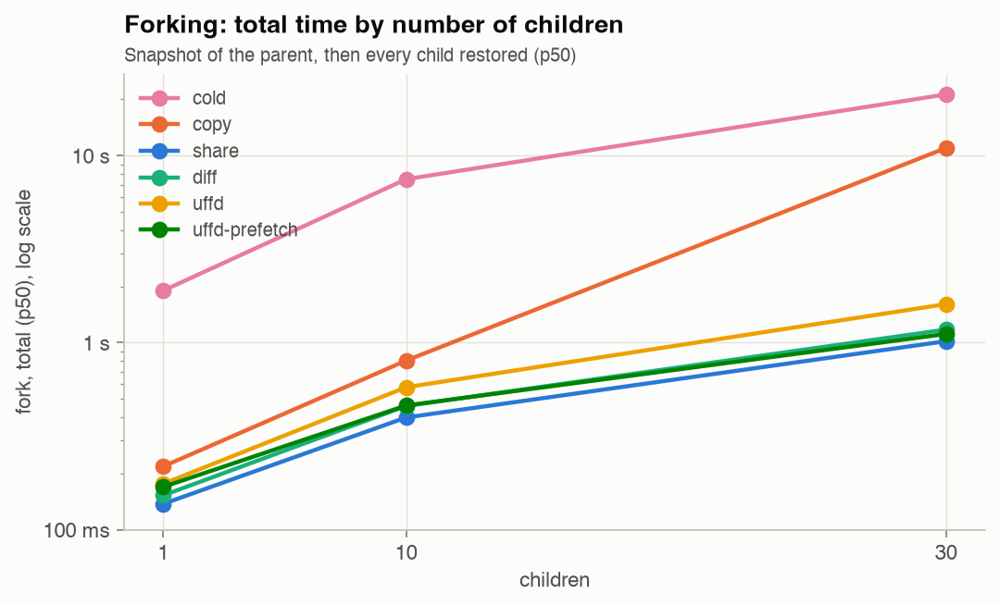
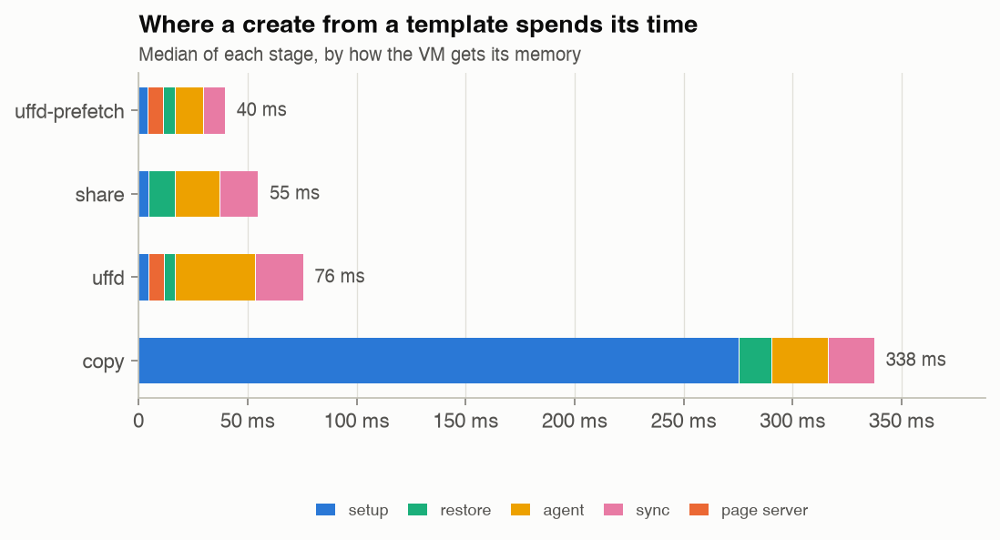
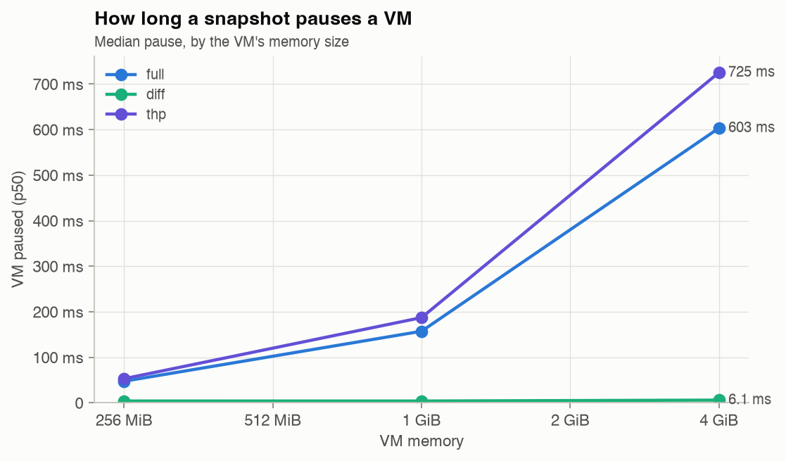
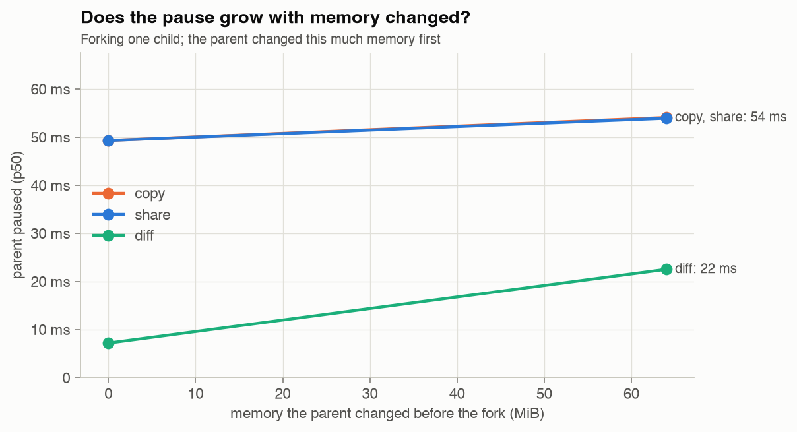
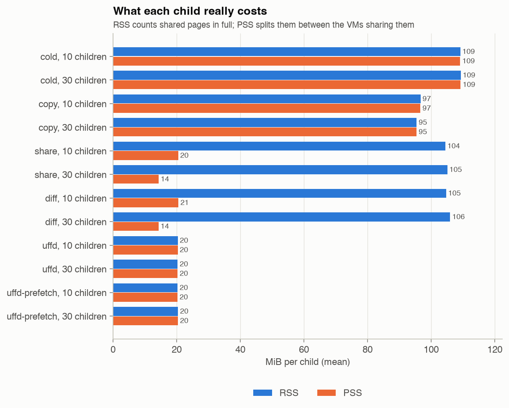
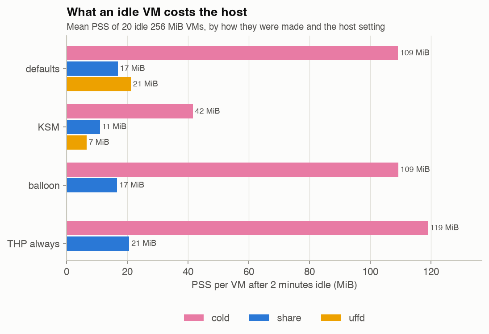
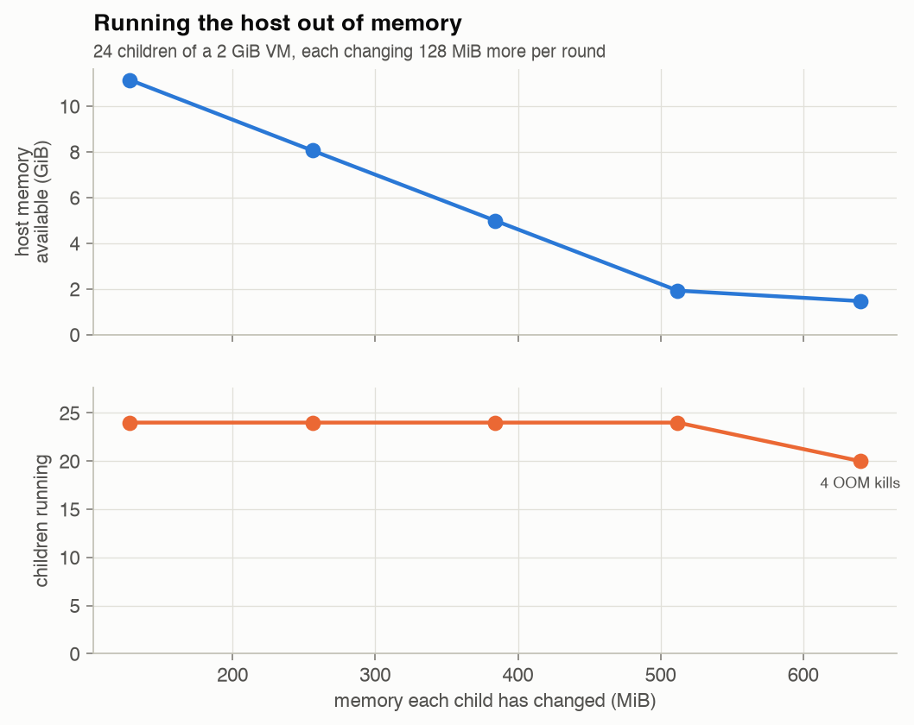

# tine: results

Step 4 measured every way tine can give a VM its memory, side by side, on the same host and in the same way. It also measured the host settings that change what a VM costs, and pushed each limit until something broke. This page is what came out: the numbers, where the time goes, and why.

Everything here is from one run of `bench/run.sh` per host. The raw results, a table of every data point and the charts are in [`bench/results/`](../bench/results/), and anyone with a KVM host can rerun it ([below](#rerunning-it)).

- [The hosts](#the-hosts)
- [The short version](#the-short-version)
- [The ladder](#the-ladder)
- [Where the time goes](#where-the-time-goes)
- [Snapshots](#snapshots)
- [What a VM costs](#what-a-vm-costs)
- [Host settings](#host-settings)
- [What breaks](#what-breaks)
- [Nested virtualization against bare metal](#nested-virtualization-against-bare-metal)
- [How it was measured](#how-it-was-measured)
- [Rerunning it](#rerunning-it)

## The hosts

| | Nested | Bare metal |
|---|---|---|
| Instance | AWS m8i.xlarge, ap-south-1 | AWS c5d.metal, ap-south-1 |
| Virtualization | Firecracker's guests run through **nested virtualization** (KVM inside an EC2 VM) | KVM on the machine itself |
| CPU | Intel Xeon 6975P-C, 4 vCPUs | Intel Xeon Platinum 8275CL, 96 vCPUs |
| Memory | 16 GiB | 192 GiB |
| `/srv/tine` | EBS gp3 volume (about 150 MB/s of writes) | Local NVMe SSD |
| Results | [`2026-11-08-nested`](../bench/results/2026-11-08-nested/) | Next |

Both ran Firecracker v1.17.0, the guest kernel 6.18.56 and the Ubuntu 24.04 base image, on Ubuntu 24.04's AWS kernel, with `vm.dirty_ratio` at 60 and transparent huge pages at `madvise`. Unless a part says otherwise, a fork's parent has 1 vCPU and 256 MiB, and a create 2 vCPUs and 1 GiB.

The numbers below are from the nested host unless they say bare metal: it's the dev server, where most of the work happened, and every number on it was measured. The bare-metal run compares them in [its own section](#nested-virtualization-against-bare-metal).

## The short version

| What | p50 |
|---|---|
| Create a VM from a template (`share`) | **57 ms**; 41 ms through a page server with prefetch |
| Cold-boot a VM | 1.83 s |
| Fork a running VM into 10 | **398 ms**, the parent paused 64 ms |
| Fork into 30 | 1.02 s, the parent paused 65 ms |
| Boot 10 or 30 fresh VMs instead | 7.5 s, 21.3 s |
| Snapshot a running VM: pause for 256 MiB, 1 GiB, 4 GiB | 48 ms, 157 ms, 601 ms |
| The same with diff snapshots, little changed | **4.2 ms, 4.0 ms, 6.1 ms** |
| Roll back to a snapshot | 66 ms |
| Run `true` in a VM through the API | 1.9 ms |
| An idle fork child's host memory, one of 30 (PSS) | **14 MiB**, against 109 MiB for a booted VM |
| A child's first write to a page it shares with its parent | 62 µs (nested); 1.1 µs per 4 KiB page with 2 MiB huge pages |

Forking is about 20 times faster than booting the same number of VMs, and an idle child costs an eighth of a booted VM. Snapshots pause a VM in proportion to its memory, unless diff snapshots save only what changed. The slowest thing left is a child's first write to each page of shared memory, and that's mostly nested virtualization's cost.

## The ladder

The plan had five ways ("rungs") to give a new VM its memory, each a strategy tined can switch between, so they could be measured side by side:

1. **cold**: no fork at all. Boot fresh VMs: the baseline.
2. **copy**: snapshot the parent, then give each child its own copy of the memory file.
3. **share**: snapshot the parent, and map the one file into every child, privately: the kernel shares its pages through the page cache and copies a page only when a child writes it. tine's default.
4. **diff**: `share`, with tined tracking the pages the parent writes, so its next snapshot writes only those (`--diff-snapshots`).
5. **uffd**: the child starts with no memory at all, and a page server, `tine-uffd`, copies each page in through userfaultfd when the guest first touches it. **uffd-prefetch** also records the pages a snapshot's first restore touches, and copies those in before later restores ask.



| Fork of a 256 MiB VM into | 1 | 10 | 30 | Child's PSS, 30 children |
|---|---|---|---|---|
| cold (booting that many) | 1.90 s | 7.49 s | 21.3 s | 109 MiB |
| copy | 218 ms | 803 ms | 11.0 s | 95 MiB |
| **share** | **138 ms** | **398 ms** | **1.02 s** | **14 MiB** |
| diff | 153 ms | 458 ms | 1.17 s | 14 MiB |
| uffd | 176 ms | 578 ms | 1.61 s | 20 MiB |
| uffd-prefetch | 170 ms | 462 ms | 1.11 s | 20 MiB |

- **cold** costs a whole boot per VM, about 1.9 s, and four CPUs boot about four at a time, so 30 take 21 s.
- **copy** pays for copying 256 MiB per child. Ten children copy 2.5 GiB, which the page cache absorbs. Thirty copy 7.5 GiB on a 16 GiB host, the kernel starts writing the copies to the disk to make room, and the slowest child takes 3.4 s: 11 s in all. Each child keeps its own 95 MiB.
- **share** is the fastest at every size, and the cheapest: one snapshot, then each child is a restore of about 70 ms (120 ms with four at once), and 30 children share their parent's memory down to 14 MiB each.
- **diff** forks as fast as `share`, as it should: a fresh parent's first snapshot is a full one. What it changes is the pause of every snapshot after the first, [below](#snapshots).
- **uffd** is the slowest of the forks. Each child's page server copies in every page the guest touches as it wakes up, one fault at a time, where `share` maps pages the page cache already has. Its children don't share memory: each has its own copy of what it touched, 20 MiB, however many children there are.
- **uffd-prefetch** wins back most of that. The first child of a snapshot is restored alone, recording what it touches (about 100 ms); the others get those pages copied in before they run. It's the fastest way to create one VM from a template (41 ms), and close to `share` for forks.

The parent's pause doesn't depend on the strategy or on the number of children: it's the snapshot, 64 ms for 256 MiB, before any child exists.

**Huge pages.** With `--page-server-huge-pages 2M`, the page servers back guests with 2 MiB pages from a reserved pool, so one fault brings in 512 times as much. A fork into 10 then takes 352 ms (uffd) and 345 ms (uffd-prefetch), faster than `share`'s 398 ms, and a child's first write to its parent's memory costs 1.1 µs per 4 KiB page instead of 47 to 62 µs. The cost is memory: every page a child touches costs it 2 MiB, from a pool reserved up front (`vm.nr_hugepages`), which RSS and PSS don't even count. It's a good trade for children that go on to write most of their memory, and a poor one for idle children.

## Where the time goes



A create from a template, by stage (p50, ms):

| Strategy | Setup (allocate, network, jail, start) | Page server | Restore | Agent answers | Sync | Total |
|---|---|---|---|---|---|---|
| share | 4.7 | | 12.3 | 20.4 | 17.7 | **56.5** |
| copy | 275 (copying the memory file) | | 15.1 | 25.7 | 21.4 | 339 |
| uffd | 4.9 | 7.2 | 5.0 | 36.4 | 22.2 | 77.5 |
| uffd-prefetch | 4.6 | 7.0 | 5.5 | 12.9 | 9.9 | **41.0** |

- **Restore** is Firecracker loading the snapshot and resuming the guest. With a page server it's faster (5 ms), as there's no file to map, but the guest then waits for its pages.
- **Agent answers** is the guest waking up: its kernel and tine-agent running again, every page they touch faulted in. That's where `uffd` loses (36 ms of single page faults) and `uffd-prefetch` wins (13 ms: its pages are already there).
- **Sync** is tine-agent setting the guest's clock, randomness, hostname and machine ID. It also touches memory, so prefetching halves it too.
- tine's own work, the setup, is under 5 ms. A cold boot is 1.83 s, of which tine's work is about 32 ms and the guest's boot the rest.

A fork is a snapshot (the parent's pause plus a few ms), then the children restored like creates, as many at once as the host has CPUs. On four CPUs a child takes about 70 ms alone and 120 ms with three others; 30 children take about 950 ms.

## Snapshots



A full snapshot pauses the VM while Firecracker writes all its memory into the page cache: 48 ms for 256 MiB, 157 ms for 1 GiB, 601 ms for 4 GiB, about 150 ms per GiB. These are a VM's snapshots after its first; the first snapshot of a fresh VM, as in a fork, pauses it about 64 ms for 256 MiB. The 4 GiB p99 is 4.2 s, when the kernel's dirty-page limits throttle the write; it was 22 s before `vm.dirty_ratio` was raised to 60 (see [architecture.md](architecture.md#taking-a-snapshot)).

**Diff snapshots** pause the VM for 4 to 6 ms, whatever its size, when it changed little since its last snapshot. Firecracker writes only the pages KVM saw written, and tined builds the full memory file afterwards, while the VM runs: a reflink copy of the last one, with the changed pages written into it (about 25 ms more). The pause grows with what changed:



| Parent changed before the fork | 0 | 64 MiB |
|---|---|---|
| Full snapshot (share, copy) | 49 ms | 54 ms |
| Diff snapshot | 7 ms | 22 ms |

These are forks of a 256 MiB parent after a first snapshot. Changing 256 MiB, the parent's whole memory, OOM-killed the guest's own workload, so tine-bench now gives this parent 1 GiB.

**The wait.** A VM's next snapshot waits until the last one has reached the disk, and 2 s more: 3 s for 256 MiB, 9 s for 1 GiB and 33 s for 4 GiB on the EBS volume. Snapshotting sooner paused the VM for up to 1.3 s, as the kernel was still throttling it ([below](#what-breaks)). The VM runs meanwhile, but a fork right after a snapshot waits too: those forks above took 3.2 s in all. Diff snapshots shorten the pause, not this wait.

Rollback restores a snapshot into the same VM in 66 ms.

## What a VM costs



RSS counts every page a process has mapped; PSS divides shared pages between the processes sharing them, so it adds up to what the host really spends.

- A **booted** VM of 256 MiB costs 109 MiB once idle, and a **copy** child 95 MiB: their memory is their own.
- A **share** child maps about 105 MiB of its parent's memory, but shares it: with 10 children its PSS is 20 MiB, with 30 it's 14 MiB. Most of what's left is the page tables and Firecracker itself.
- A **uffd** child has only what it touched, 20 MiB, all of it its own, so more children don't make it cheaper.
- The most children on the nested host was **31** of one 256 MiB VM, with 14.4 GiB still available: admission control's vCPU limit stopped it, at 8 vCPUs per host CPU, set to keep the host below the ~60 guest vCPUs where EC2's nested virtualization fails.

## Host settings

Each changed one thing, and ran the scenarios it could change.



**KSM** (`--ksm`, kernel samepage merging, with `ksmd` scanning 4,000 pages every 20 ms) merges identical pages across VMs. Twenty idle booted VMs went from 109 to 42 MiB each, as they run the same kernel and programs; `share` children from 17 to 11 MiB, and `uffd` children from 21 to 7 MiB, as each had its own copies of the same pages. The cost is `ksmd`'s CPU, and a copy when a merged page is written again. It's the biggest saving for idle VMs, and stays a flag.

**The balloon** (`--balloon`, with free page reporting) gives memory the guest frees back to the host. Idle VMs saved nothing measurable (109 and 17 MiB, as without it): a guest that has just booted and sits idle hasn't freed much it had touched. It's for guests that use memory, then free it.

**Transparent huge pages** (`always` on the host) made cold boots 11% faster (1.64 s against 1.83 s), but made booted VMs bigger (119 MiB against 109) and snapshots slower (187 ms against 157 for 1 GiB, 727 against 601 for 4 GiB). Forks and a child's first write didn't change: the memory file's pages are 4 KiB whatever THP says. tine leaves it at `madvise`.

## What breaks

Pushing each limit until something failed, and what it took:

1. **Running out of host memory.** 24 children of a 2 GiB VM, each changing 128 MiB more of its memory per round:

   

   Admission control let all 24 in: it counts what VMs use now (the children shared almost everything), and allows guests to promise up to four times the host's memory (`--overcommit`). At 512 MiB each, 12 GiB in all, the host had 2 GiB left and everything still ran. At 640 MiB, the kernel reclaimed until nothing was left, a round took 6 to 16 s instead of 4, and its OOM killer killed whole VMs: 2 to 5 of the 24 in each of the four runs. tined saw their Firecrackers die and marked them failed; the others kept running. The limit is the overcommit setting: children that will really change their memory need it lower, or KSM.

2. **Nested virtualization's guest limit.** Past about 60 guest vCPUs, EC2's nested virtualization refuses to enter more guests (found in step 3), so tine's vCPU limit stops the nested host at 32, and 31 children. Bare metal doesn't have it.

3. **The page cache under pressure.** If memory pressure pushes a fork's memory file out of the page cache, its children read their parent's memory from the disk. `fork-evict` drops the page cache before children read 128 MiB they share, but the reads stayed fast: 146 ns a page against 137 ns with nothing dropped (`share`), 205 against 190 ns (`uffd`). At 4 KiB per page, that's far faster than the EBS volume can read, so dropping the cache didn't evict those pages, and this run doesn't show the cliff. A check afterwards showed why: of a fork's 256 MiB memory file, 102 MiB stayed in the page cache after `drop_caches`, which can't drop pages a process has mapped, and each child maps about 100 MiB of its parent's memory as it restores (its RSS). Real eviction needs real memory pressure, which reclaims mapped pages too; the pressure run above ran out of memory before it showed.

4. **Snapshots of big VMs.** A 4 GiB snapshot is 4 GiB of new dirty pages at once. Past the kernel's dirty limits it's written at the disk's speed, and the VM stays paused: 22 s with the default `vm.dirty_ratio` of 20, 4.2 s at the p99 with 60. Diff snapshots avoid it for VMs that change little.

5. **Back-to-back snapshots.** Right after a snapshot's memory reached the disk, the next snapshot of the same VM paused it for 0.3 to 1.3 s instead of 60 ms: the kernel was still throttling the VM's cgroup, which had just written gigabytes. tined now waits until 2 s after the last flush. That wait is why a fork right after a snapshot takes 3 s.

6. **Forking a parent too early.** Forked the moment its agent answered, a parent's children each finished its boot themselves: 30 children took 5 s instead of 1. Forked the moment systemd called the boot done, they each finished systemd's last units: 850 ms for 10 instead of 450. Templates and the benchmark's parents now wait for systemd, then 2 s more.

7. **Copying memory for 30 children.** 7.5 GiB of copies on a 16 GiB host pushed the page cache to the disk: 11 s for the fork, against 800 ms for 10.

8. **A guest changing all its memory.** A 256 MiB guest can't hold 256 MiB of new data next to its own kernel and programs: its own OOM killer killed the workload. That's the guest's limit, not the host's.

## Nested virtualization against bare metal

The bare-metal run, on a c5d.metal, is next.

## How it was measured

- **One harness.** `tine-bench` drives tined's API, as any client would, and writes a JSON line per run: tined's own stage timings, the client's, and memory figures. The first line describes the host: instance type, whether it's virtualized, CPU, kernel, Firecracker and tine versions, the data disk, and the kernel settings that matter. `bench/analyze.py` turns a results file into `summary.md` and the charts.
- **Runs.** Each data point starts with warm-up runs (recorded, marked, and left out), then 100 runs for creates, execs and rollbacks, and 10 for forks and snapshots, each of which boots a fresh parent. The tables give n, p50, p95, p99, min and max.
- **Quiet first.** Before each data point, tine-bench waits until the kernel has written dirty pages out, since a snapshot's flush slows everything else on the disk.
- **Settled parents.** A fork's parent is forked once its guest has finished booting (`systemctl is-system-running --wait`) and then had 2 s more, as a template is saved. Forked the moment it answered, every child finished the boot at once: 30 children took 5 s instead of 1. Forked the moment systemd said the boot was done, every child finished systemd's last units: 10 children took 850 ms instead of 450.
- **Copy-on-write, one child at a time.** `fork-touch` has four children, one after another, write every page their parent filled. All ten at once, on four CPUs, measured the CPUs being shared as much as the faults: 250 µs a page instead of 60.
- **One thing at a time.** Each part of `bench/run.sh` changes one setting: a fork strategy, a tined flag, or one host setting, which it puts back afterwards.
- **Labelled.** Every run carries what tined ran with (`"features"`), and the host line says where it ran. Numbers from the dev server are **nested virtualization**.
- **Memory.** RSS and PSS are each VM's Firecracker process, from `/proc/<pid>/smaps_rollup`, three seconds after the fork. Memory in huge pages from a reserved pool (hugetlbfs) isn't in either, so the memory chart leaves `+2M` out.

## Rerunning it

On any Linux host with KVM, set up with `scripts/host-setup.sh` and with tine installed (`make deploy bench-image` does both on the dev server):

```bash
bench/run.sh /tmp/tine-bench.jsonl
```

That runs every part, about five hours on four CPUs, and puts the host's settings back when it ends. `PARTS="base pages"` runs some parts, `QUICK=1` fewer runs of each, and `BENCH_FLAGS` passes tine-bench flags to every part, such as more children on a bigger host. From a Mac, `make bench-all` does it all on the dev server, fetches the results into `bench/results/<date>-<name>/` and charts them:

```bash
make bench-all BENCH_NAME=nested
```

The bare-metal run was the same, on a second server:

```bash
export TINE_NAME=tine-metal TINE_INSTANCE_TYPE=c5d.metal TINE_LOCAL_DATA=1
./scripts/dev-server.sh up && ./scripts/dev-server.sh setup
make base-image bench-all BENCH_NAME=metal BENCH_FLAGS="-children 1,10,30,100 -pressure-vms 96 -pressure-memory 2560"
```

`uv run bench/analyze.py DIR` charts a results directory; given several, it compares them (`--out DIR`).
